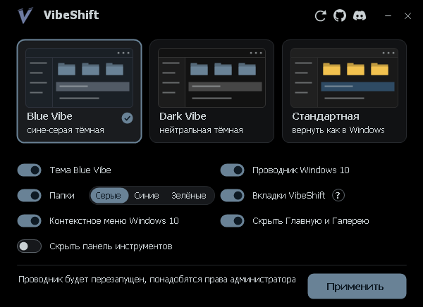
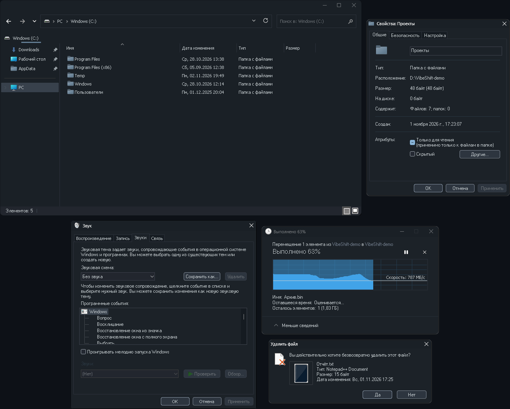

<div align="center">

# VibeShift

**Тёмная Windows 11 в один клик**<br>
Две выверенные темы, цвет папок, привычный Проводник и вкладки как в браузере

[**Скачать последнюю версию**](../../releases/latest)



</div>

## Что это

VibeShift красит в одну тему то, что обычная тема Windows не достаёт: старые диалоги, окна копирования, свойства, «Выполнить», заголовки и рамки окон. Выбираете карточку, отмечаете нужное и нажимаете «Применить». Всё можно вернуть одной кнопкой.

## Как это выглядит



## Что внутри

| | |
|---|---|
| **Blue Vibe** | сине-серая тёмная тема |
| **Dark Vibe** | нейтральная тёмная тема без оттенка |
| **Цвет папок** | серые или синие, с любой темой. Папки остаются сплошными: содержимое не просвечивает 
| **Проводник** | На Windows 11 возвращает привычный вид Проводника из Windows 10.<br>На Windows 10 скрывает ленту команд в верхней части окна. |
| **Контекстное меню Windows 10** | классическое меню по правому клику на Windows 11 |
| **Вкладки VibeShift** | встроенные вкладки для Проводника |
| **Стандартная** | возвращает выбранное к стандартному виду Windows |

Каждый пункт включается отдельно. Файлы иконок меняются, только если включён переключатель «Папки».

## Как пользоваться вкладками

Включите «Вкладки VibeShift» и нажмите «Применить».

- Нажмите средней кнопкой мыши на папку, чтобы открыть её в новой вкладке.
- Нажмите средней кнопкой на вкладку, чтобы закрыть её. Двойной щелчок рядом с вкладками вернёт последнюю закрытую.
- Перетащите файлы на вкладку, чтобы скопировать или переместить их в её папку.
- По правому клику на полосе вкладок доступны параметры папок Windows и переключатель показа скрытых элементов.

## Установка

1. Скачайте `VibeShift.exe` со страницы [релизов](../../releases/latest).
2. Запустите, выберите тему и нажмите «Применить».

Устанавливать ничего не нужно. Служебные файлы лежат в скрытой папке `C:\Program Files\VibeShift`.

## Что нужно

- **[UltraUXThemePatcher](https://mhoefs.eu/software_uxtheme.php?lang=en)**: Windows загружает только темы с подписью Microsoft. Если патчера нет, VibeShift сам предложит его скачать. На Windows без патчера доступен возврат к стандартному виду. На Windows 10 настройки Проводника доступны отдельно.
- Права администратора. Проводник при применении перезапустится.

## Как отличить настоящую копию

VibeShift запрашивает права администратора и меняет системные файлы, поэтому подделка с вирусом опасна. Перезалить чужую программу на другой сайт, к сожалению, может кто угодно.

- **Скачивайте только со страницы [релизов](../../releases/latest) этого репозитория.** 
- **Сверьте контрольную сумму.** У каждого релиза указан SHA-256 файла. Посчитать его у себя можно в PowerShell:
  ```powershell
  Get-FileHash .\VibeShift.exe -Algorithm SHA256
  ```
  
## Важно знать

- VibeShift меняет системные файлы и настройки оболочки. Перед первым запуском можете сделать точку восстановления. Вы используете программу на свой риск.
- Файл не подписан сертификатом, поэтому Windows SmartScreen может показать предупреждение, а антивирус может отреагировать на замену системных файлов.
- Крупные обновления Windows могут вернуть стандартные файлы. Тогда просто примените тему ещё раз.

Используемые сторонние компоненты перечислены в [THIRD-PARTY-NOTICES.md](THIRD-PARTY-NOTICES.md).

## Недостатки

- Порой в старых программах вы встретите светлые окна: светлый шрифт на них читается хуже, а кнопки окрашены в цвет выбранной темы.
- Полностью исправить это темой нельзя. Такие программы рисуют окна по правилам времён Windows 95, когда о тёмной теме никто и не думал, и часть цветов задают сами.
- На некоторых сайтах текст в полях ввода может быть бледным: браузер берёт его цвет из темы Windows, а сайт задаёт полю белый фон.
---

### English

**VibeShift** is a one-click dark makeover for Windows 10 and 11: two themes (Blue Vibe, Dark Vibe), folder colors, a Windows 10 style Explorer and built-in VibeShift tabs, all reversible with one button. Requires [UltraUXThemePatcher](https://mhoefs.eu/software_uxtheme.php?lang=en) and administrator rights. It modifies system files, so create a restore point first and use it at your own risk.
